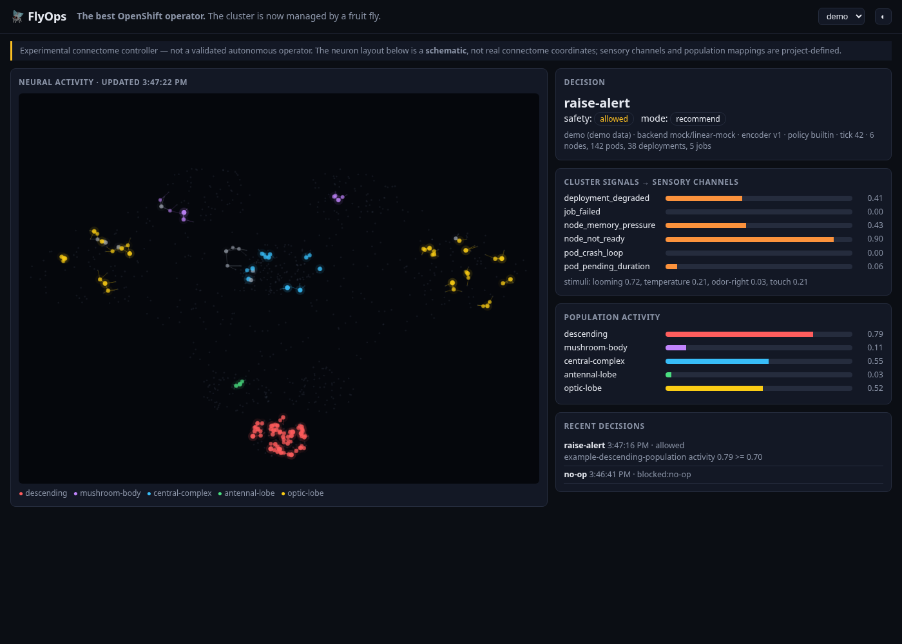

# FlyOps: an OpenShift operator with a fruit fly's brain

**The best OpenShift operator.** A real fly brain watches your cluster. Flip one switch and it starts fixing things.



**The fly:** *Drosophila melanogaster*, one adult female. Her whole brain was mapped by the FlyWire Consortium:
**138,639 neurons** and **15,091,983 connections**. FlyOps simulates all of it, every 5 seconds.

**How it works:** problems in the cluster become sensory input to real sensory neurons. A dead node *looms*,
crash-looping pods *smell*. The brain runs for 250 ms, and FlyOps reads which neurons fire.

| The cluster has... | The fly senses... | Neurons that fire | The fly does (switch ON) |
|---|---|---|---|
| a node down or under pressure | something looming | escape (giant fibre) | **drains the node** |
| a broken Deployment / StatefulSet / DaemonSet | an abrupt flash | optic lobe | **rollout-restarts it** |
| a crash-looping pod | an odour | antennal lobe, mushroom body | **deletes the pod** (its controller recreates it) |

> Experimental. A fun demo of a connectome running real infrastructure, not a validated autonomous operator.

## Install
Needs Helm 3.8+, `oc`, cluster-admin, and an amd64 OpenShift 4 cluster.
```bash
helm install flyops oci://quay.io/eelgaev/flyops-operator --version 0.2.0 -n flyops-system --create-namespace
```
Open the dashboard and log in with your OpenShift account:
```bash
echo "https://$(oc -n flyops-system get route flyops-dashboard -o jsonpath='{.spec.host}')"
```
Plain Kubernetes: add `--set oauthProxy.enabled=false --set route.enabled=false`, then
`kubectl -n flyops-system port-forward svc/flyops-dashboard 18787:18787` (no login on this path).

## The switch
It starts **OFF**: the fly watches and thinks, and changes nothing.
```bash
curl -fsSLo oc-flyops https://raw.githubusercontent.com/eelgaev/flyops-operator/refs/heads/main/bin/oc-flyops
install -m 0755 oc-flyops /usr/local/bin/ && rm oc-flyops     # gives you `oc flyops`

oc flyops on        # the fly controls the cluster
oc flyops off       # back to watching
oc flyops status
```
No plugin? `oc patch flybrain flyops --type=merge -p '{"spec":{"enabled":true}}'` does the same.

**When ON, the fly can act anywhere in the cluster**, including system namespaces. Three rules always hold:
- at most one action per minute,
- never anything in FlyOps' own namespace (so OFF always works),
- if the brain fails, nothing happens.

See what it did: `oc get flydecisions -n flyops-system`. A drained node stays cordoned until `oc adm uncordon <node>`.

## Uninstall
```bash
helm uninstall flyops -n flyops-system
helm show crds oci://quay.io/eelgaev/flyops-operator --version 0.2.0 | oc delete -f -
oc delete namespace flyops-system
```

## Build it yourself
```bash
git clone https://github.com/eelgaev/flyops-operator.git && cd flyops-operator
podman build --platform linux/amd64 -t <registry>/flyops:0.2.0 .
helm install flyops deploy/helm/flyops-operator -n flyops-system --create-namespace \
  --set image.repository=<registry>/flyops --set image.tag=0.2.0
```
One Rust crate (`src/`). The build downloads the FlyWire data (100 MB, checksum-verified). The simulator is a Rust
re-implementation of the Shiu et al. 2024 leaky integrate-and-fire model; it has **not** been validated against the
original. The choice of which real neurons stand for each channel is ours: [`hack/flywire_mapping.py`](hack/flywire_mapping.py).

## Credits
FlyOps stands on other people's science. The fly brain inside it is their work; FlyOps only wires it to a cluster.

- **The FlyWire Consortium** mapped the whole adult fly brain this operator simulates:
  Dorkenwald, S. *et al.* Neuronal wiring diagram of an adult brain. *Nature* **634**, 124–138 (2024).
  [doi:10.1038/s41586-024-07558-y](https://doi.org/10.1038/s41586-024-07558-y) ·
  [flywire.ai](https://flywire.ai) · connectivity release v783, [CC BY 4.0](https://doi.org/10.5281/zenodo.10676866).
- **Philip Shiu, Nico Spiller and colleagues** built the leaky integrate-and-fire model that FlyOps re-implements in
  Rust, and published the v783 neuron and connectivity files the image downloads:
  Shiu, P. K. *et al.* A *Drosophila* computational brain model reveals sensorimotor processing. *Nature* **634**, 210–219 (2024).
  [doi:10.1038/s41586-024-07763-9](https://doi.org/10.1038/s41586-024-07763-9) ·
  [philshiu/Drosophila_brain_model](https://github.com/philshiu/Drosophila_brain_model) (MIT).
- **Philipp Schlegel, Gregory Jefferis and colleagues** annotated every neuron with a cell type; FlyOps uses those
  annotations to pick which real neurons stand for each sensory channel and readout population:
  Schlegel, P. *et al.* Whole-brain annotation and multi-connectome cell typing of *Drosophila*. *Nature* **634**, 139–152 (2024).
  [doi:10.1038/s41586-024-07686-5](https://doi.org/10.1038/s41586-024-07686-5) (CC BY 4.0) ·
  [flyconnectome/flywire_annotations](https://github.com/flyconnectome/flywire_annotations) v2.1.0.

FlyOps changed the material: the simulator is a re-implementation, not the original code, and the choice and grouping
of cell types is FlyOps' own. None of these authors reviewed or endorsed FlyOps. If you publish anything made with it,
cite the three papers above. The image carries the same attributions in `/opt/flyops/brain/NOTICE`.

Built with [kube-rs](https://github.com/kube-rs/kube) and [Apache Arrow Parquet for Rust](https://github.com/apache/arrow-rs).

## License
FlyOps code: MIT, see [LICENSE](LICENSE). The connectome data and cell-type annotations keep their own licenses
(MIT and CC BY 4.0, see [Credits](#credits) and [`data/flywire-783/NOTICE`](data/flywire-783/NOTICE)).
